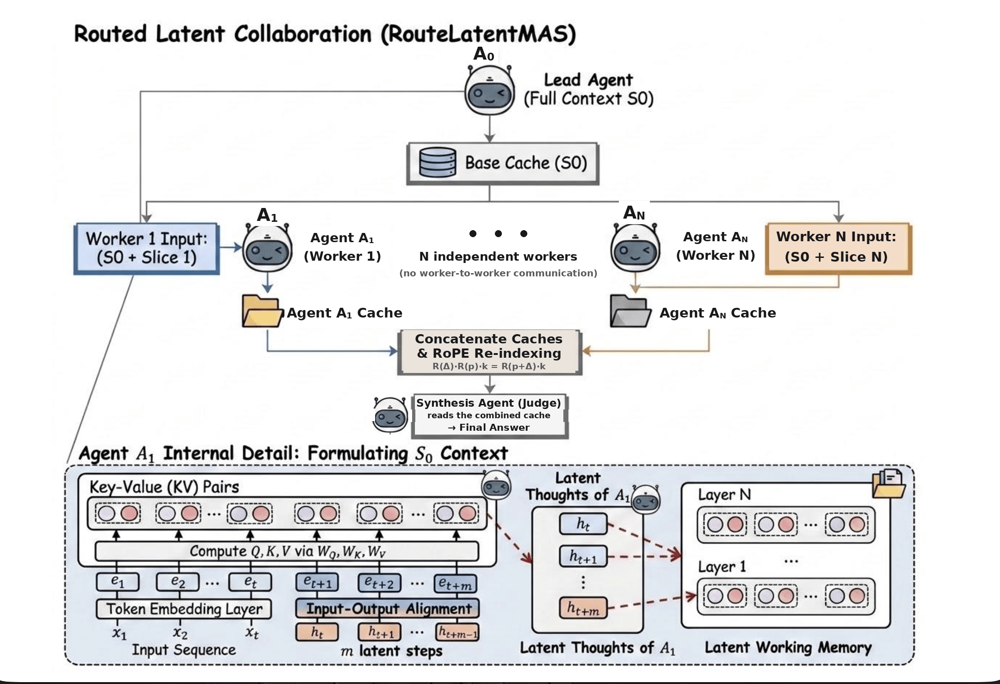
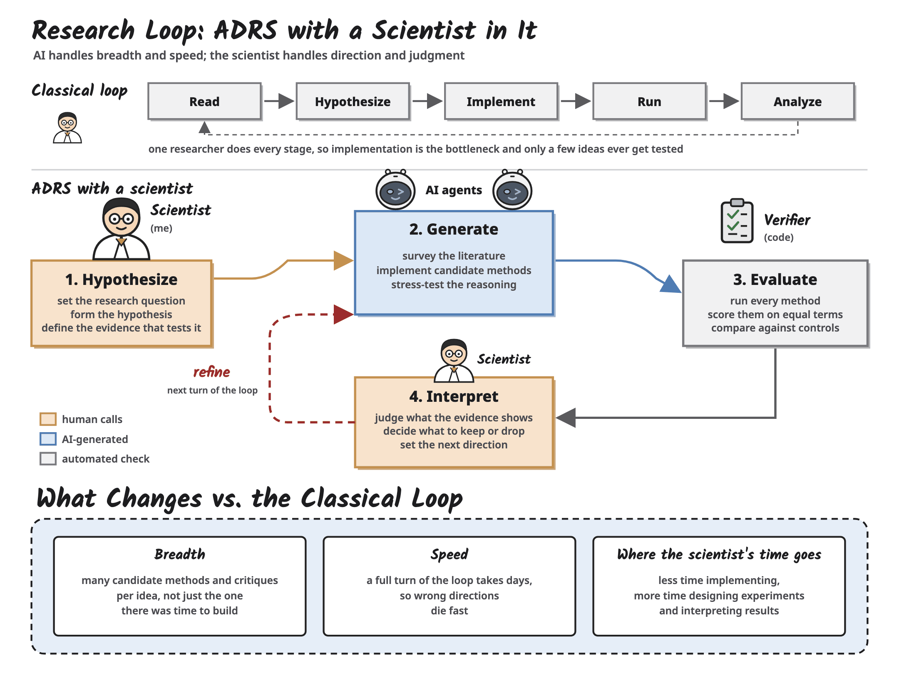

# Routed LatentMAS

**A research log: can a truly parallel multi-agent system divide *information*, not just thinking?**

I wanted to know whether LLM agents could split up a problem and hand their work to each other as **KV cache** instead of text. This is what I thought, what I built, what broke, and what I changed because of it, in the order it happened. Commit hashes link the code at each step.

Fork of [LatentMAS](https://github.com/Gen-Verse/LatentMAS) (Zou et al., [arXiv:2511.20639](https://arxiv.org/abs/2511.20639)).

LatentMAS chains agents through one shared cache. I tried to run the agents in parallel and merge their caches. The merged caches carry real information but lose to one model reading everything (50% vs. 64% exact match on HotpotQA), because parallel workers never see each other's work. Sharing the *input* cache and having workers report back in text keeps the accuracy (62%) at 40% fewer prompt tokens than handing every worker the documents.



---


## Dividing the thinking vs. dividing the information

LatentMAS has agents pass their KV cache down a chain: a planner, a critic, a refiner and a judge, each waiting for the one before it, all working on the same question. That's dividing the *thinking*: different roles reasoning over shared information, one after another.

```
same question ─→ planner ─→ critic ─→ refiner ─→ judge → answer
                 (one cache, handed down the chain)
```

I wanted a truly parallel system that divides the *information* itself, map-reduce over the context:

```
documents ─→ split ─→ worker 1 reads docs A ─┐
                   ─→ worker 2 reads docs B ─┴─→ judge → answer
```

That's what real systems need when:

- **the context is too big for one agent:** thousands of pages, a whole codebase, long logs;
- **speed matters:** read N pieces in parallel instead of one long sequential read;
- **the information is private by nature:** one agent per database, tool, or user, each seeing only its own.

It's also where latent communication gets hard. When everyone sees the same input, it doesn't matter that agents never look at each other's work. When the evidence is split, worker 2 never sees what worker 1 found, and a question that chains across both can break. This log is about that gap.

## 1. Initial idea

LatentMAS lets agents skip writing to each other. A transformer builds a KV cache as it reads, which is its working memory of the context, and LatentMAS hands that cache straight to the next agent instead of a text summary. Nothing gets flattened into natural language between agents.

I thought: if the cache can be handed off, it can be **split**. A lead reads the context once, workers each take a different slice in parallel, and a judge reads all their caches together at once. It's map-reduce, with the KV cache as the channel.

Built it as `routed_mas` ([`64d2d36`](https://github.com/JoshBong/LatentMAS/commit/64d2d36)):

1. The lead reads the shared context → base cache `S0`.
2. Each worker gets a copy of `S0` plus its own sub-task, and runs without seeing the others.
3. Each worker's new tokens are sliced off and concatenated onto `S0`.
4. The judge answers over `[S0 | worker 1 | worker 2 | ...]`.


## 2. RoPE reindexing

Every worker started right after `S0`, so all their tokens claimed the same positions. Stitched together naively, the judge read garbage.

RoPE stores a key computed at position `p` as `R(p)·k`, and rotations compose (`R(Δ)·R(p) = R(p+Δ)`), so a cached key can be moved without re-running the model:

```
k' = k ⊙ cos(Δf) + rotate_half(k) ⊙ sin(Δf)        f = the model's rotary frequencies
```

Each worker shifts by the total length of the workers before it ([`64d2d36`](https://github.com/JoshBong/LatentMAS/commit/64d2d36)). Surprisingly it worked and what I originally thought was going to be the main obstacle was solved relatively easily.

## 3. Does stitching work

With positions fixed, there was still a deeper question. Each worker's cache was built blind to the others. How much does that cost, and could that be fixed without training or recomputing?

I worked through it having two models, Claude and Gemini, research and discuss in parrellel. Each tried to break the other's position, and I oversaw and steered the conversation. Where it landed ([full write-up](docs/why-stitching-fails.md)): the loss has two parts.

- **Calibration.** Blocks encoded in parallel give the judge a miscalibrated attention distribution. That part has a training-free fix: [APE](https://arxiv.org/abs/2502.05431) rescales attention at read time and recovers 93–98% of sequential performance on retrieval and in-context learning.
- **Content.** If worker B would only have looked something up *because of* what worker A found, B never looked it up. "What was Y's revenue in the year X filed its first patent?" A finds the year; B, running blind, never pulls that year's revenue. No transform of B's cache can produce a number that was never computed.

So stitching is sound only when **no worker's job depends on another worker's findings**. Comparisons ("which city is bigger?") qualify; chains don't. I tried having a 3B router check this before splitting the work, and it was at chance (3/6), wrong in both directions ([`c52acf4`](https://github.com/JoshBong/LatentMAS/commit/c52acf4)).

## 4. No more stitching

If merging caches back together is the part that breaks, keep the part that works and drop the rest. `routed_nl` ([`0be4da0`](https://github.com/JoshBong/LatentMAS/commit/0be4da0)):

- An orchestrator writes one sub-task per worker.
- The documents are encoded **once** into a shared KV prefix and handed to every worker as a view, with no copies.
- All workers decode their findings in **one batched forward pass**, as short text.
- The judge reads the findings, not every document.

Every worker branches off the same read-only prefix, so nothing is ever merged. No cache surgery, no re-indexing, no stitching. This isn't a new idea: it's prefix caching, the same trick vLLM and SGLang use, studied for multi-agent workflows in [KVFlow](https://arxiv.org/abs/2507.07400) and for batched decoding in [Hydragen](https://arxiv.org/abs/2402.05099). What it changes relative to LatentMAS is the direction of sharing: the cache is shared on the way *in* (the documents), and results come back as text. The claim it can make is small and checkable: same accuracy as giving every worker the documents as text, with the documents paid for once instead of once per worker. `--channel` tests it with everything else fixed: `kv` (the mechanism), `text` (the cost control), `nodocs` (the kill switch: if `kv ≈ nodocs`, the shared prefix carries nothing).

## 5. Similar work

[KVShareArena](https://arxiv.org/abs/2609.10266) (Shi, Zheng, Lou) came out a week after `routed_nl`. It benchmarks KV-cache reuse across contexts, multi-agent workflows included, and finds that reusing a cache computed under different preceding text reduces answer quality, and that which repairs help depends on the model. It's a careful, large-scale version of what I ran into here, and it's the reference to read for this problem.

## 6. The comparison results

The clean comparison never got run after the scoring fix, so I ran it: HotpotQA (distractor), first 50 validation questions, seed 42, Qwen3-4B, 2 workers, one scorer for every arm. Each question needs facts from two paragraphs hidden among eight distractors.


| arm                   | what it is                                                      | EM       | F1   | prompt tokens / question |
| --------------------- | --------------------------------------------------------------- | -------- | ---- | ------------------------ |
| `single`              | one model reads all 10 paragraphs                               | **0.64** | 0.73 | –                        |
| `routed`              | parallel workers, caches stitched for the judge                 | 0.50     | 0.58 | –                        |
| `routed`, text blocks | same, workers skip the latent thinking steps                    | 0.52     | 0.61 | –                        |
| `empty_cache`         | kill switch: judge gets no worker blocks                        | 0.16     | 0.25 | –                        |
| `nl_kv` (`routed_nl`) | documents shared once through the cache, workers report in text | **0.62** | 0.69 | **2,420**                |
| `nl_text`             | same, documents pasted into every worker's prompt               | 0.62     | 0.70 | 4,022                    |
| `nl_nodocs`           | kill switch: workers get no documents                           | 0.14     | 0.21 | –                        |


What it says:

- **Stitched caches carry real information** (0.50 vs. 0.16 with the worker blocks removed), **but lose to one model reading everything** (0.64). That's section 4 measured: on a chain question, the second worker never saw what the first one found.
- **The latent thinking steps don't matter on Qwen3** (0.50 vs. 0.52). On Qwen2.5-3B they wrecked the judge's output entirely, which cost me a run before I caught it.
- `routed_nl` **matches text delivery exactly** (0.62 vs. 0.62) **with 40% fewer prompt tokens**, and its kill switch drops to 0.14, so the shared cache is what's carrying the documents.

n=50 with one seed is directional, not a benchmark result; the kill-switch gaps are large, the closer gaps aren't. Upstream `latent_mas` is left out of the table: its answers were mostly right but came as full sentences ("Yes, Scott Derrickson and Ed Wood were of the same nationality"), which strict exact match scores as wrong, so its number measures answer format, not the method.

## 7. How I worked: an ADRS loop with a scientist in it

In a classical research loop one person does every stage: read, hypothesize, implement, run, analyze. Implementation is the bottleneck, so only a few ideas ever get tested.

[ADRS](https://arxiv.org/abs/2512.14806) (AI-Driven Research for Systems; Cheng et al., following [Barbarians at the Gate](https://arxiv.org/abs/2510.06189)) turns research into a fast loop: AI **generates** candidate solutions, a verifier **evaluates** them, and the loop **refines**. The papers push toward automating the whole thing. I ran it with a scientist at both ends. I set the question and the hypothesis and decided what evidence would test it. AI agents surveyed the literature, implemented candidate methods, and stress-tested the reasoning. Code scored every method on equal terms against controls. Then I interpreted the evidence and set the next direction.



What that buys over the classical loop is breadth (many candidate methods and critiques per idea, not just the one there was time to build), speed (a turn of the loop takes days, so wrong directions die fast), and a different use of the scientist's time: less implementing, more designing experiments and interpreting results.

## 8. What's next

The content loss is the real problem, and it can't be fixed after the fact: no transform of a blind cache adds information it never computed. Two ways forward:

**A trained translator instead of glued caches.** [RecursiveMAS](https://arxiv.org/abs/2604.25917) (the LatentMAS authors' follow-up) doesn't pass KV caches at all. A worker's hidden states go through a small trained adapter and get spliced into the receiver's prompt as input embeddings, so the receiver re-reads them from the first layer and builds the cross-worker attention itself. That's exactly what stitching can't do. The version I'd test here: workers stay parallel, their outputs come back as a few dozen latent slots in the judge's prompt instead of text findings, and the question is whether that beats `routed_nl`'s text at the same token budget, especially on chain questions where the workers depend on each other.

**A search over the calibration half.** How the judge's attention reads stitched blocks (temperature, scaling, per-block weighting) is a short, parameter-free program, which suits an automated search step inside the loop above. That only works with a verifier I'd build myself first: hundreds of held-out questions, multiple seeds, and a synthetic recall task with unambiguous answers, because n=50 is noise and a search would select the noise.

---


## Running it

```bash
git clone https://github.com/JoshBong/LatentMAS.git && cd LatentMAS
pip install -r requirements.txt "transformers>=5" matplotlib   # results in section 7 used transformers 5

# routed fan-out (2 entities -> 2 workers)
python run.py --method routed_mas --model_name Qwen/Qwen3-4B --task hotpotqa --num_workers 2 --do_not_enforce_qwen

# shared prefix + batched workers + text findings, and its two controls
python run.py --method routed_nl --channel kv     --model_name Qwen/Qwen3-4B --task hotpotqa --do_not_enforce_qwen
python run.py --method routed_nl --channel text   --model_name Qwen/Qwen3-4B --task hotpotqa --do_not_enforce_qwen
python run.py --method routed_nl --channel nodocs --model_name Qwen/Qwen3-4B --task hotpotqa --do_not_enforce_qwen

# the comparison in section 7 (resumable, one folder per arm)
python experiments/run_suite.py --model Qwen/Qwen3-4B --tasks hotpotqa \
    --arms single empty_cache routed nl_kv nl_text nl_nodocs --seeds 42 --max_samples 50 --num_workers 2 --out results/gate
python experiments/analyze.py --out results/gate

python -m pytest -q tests   # 49 tests: cache ops, RoPE re-index, batched prefix decode, scoring parity
```

`--method baseline` is one agent with full context; `--method latent_mas` is the upstream chain; `--no_reindex` turns off the position fix.

## Credit

Fork of [LatentMAS](https://github.com/Gen-Verse/LatentMAS) — Zou et al., *Latent Collaboration in Multi-Agent Systems*, [arXiv:2511.20639](https://arxiv.org/abs/2511.20639). The routed methods, KV-cache operations, router, and experiment harness are this fork's additions.

---

Research log, Jul–Oct 2026. Full dated commit history available on request.